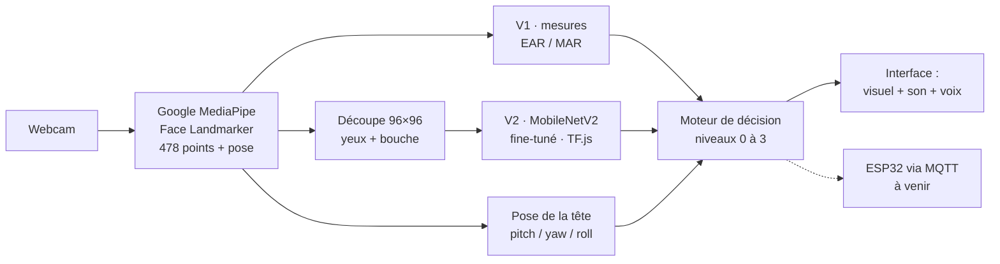

# DriveAlert AI · Détection de la somnolence du conducteur en temps réel

> Projet de Fin d'Année (PFA) · EMSI
> Détection de la somnolence du conducteur en temps réel avec système d'alerte.

DriveAlert AI filme le conducteur avec une webcam et détecte :

- les **yeux fermés** trop longtemps ;
- les **bâillements** ;
- la **tête qui tombe** ;
- le **regard détourné** de la route.

Il déclenche des **alertes à 4 niveaux** : visuelles, sonores et vocales.
Tout tourne **dans le navigateur**, et aucune image n'est envoyée sur Internet.

Le projet compare **deux versions** de la détection :

| Version | Visage, points du visage, pose de la tête | Yeux ouverts / fermés et bâillement |
|---|---|---|
| **V1** | Google MediaPipe Face Landmarker | Mesures géométriques : EAR, MAR (ou scores de Google) |
| **V2** | Google MediaPipe Face Landmarker | **Notre modèle** : MobileNetV2 fine-tuné sur nos propres images |

---

## Sommaire

1. [Fonctionnalités](#fonctionnalités)
2. [Architecture](#architecture)
3. [Installation et lancement](#installation-et-lancement)
4. [Utilisation : les 3 onglets](#utilisation--les-3-onglets)
5. [Règles d'alerte](#règles-dalerte)
6. [Base de données d'images](#base-de-données-dimages)
7. [Entraînement du modèle V2](#entraînement-du-modèle-v2)
8. [Résultats](#résultats)
9. [Structure du projet](#structure-du-projet)
10. [Technologies](#technologies)
11. [Limites et suite du projet](#limites-et-suite-du-projet)

---

## Fonctionnalités

- **Détection en temps réel** depuis la webcam, à environ 30 images par seconde, avec accélération GPU si possible.
- **Calibration automatique** pendant 5 s au démarrage : les seuils s'adaptent au visage de chaque conducteur.
- **4 niveaux d'alerte** : Normal, Vigilance, Alerte, Danger.
  - Niveaux 2 et 3 : cadre clignotant plein écran et bips.
  - Niveau 3 : bandeau « RÉVEILLEZ-VOUS ! » et message vocal.
- **Indicateurs affichés** :
  - EAR, MAR et PERCLOS (part du temps passé les yeux fermés sur 60 s) ;
  - clignements, bâillements, hochements de tête ;
  - angles de la tête ;
  - courbes en direct et historique des événements.
- **Tous les seuils sont réglables** dans l'interface.
- **Outil de collecte et d'étiquetage** des images pour l'entraînement : capture manuelle ou automatique, galerie de vérification, découpage entraînement / validation / test.
- **Modèle V2 fine-tuné**, qui tourne dans le navigateur avec TensorFlow.js, pour comparer directement avec la V1.

## Architecture



Le **moteur de décision** est le même pour les deux versions. Seule change la façon de décider « yeux fermés » et « bâillement ». La comparaison V1 / V2 est donc équitable.

## Installation et lancement

**Prérequis :**

- Node.js 20 ou plus (testé avec 22) ;
- un navigateur récent (Chrome, Edge ou Safari) avec une webcam.

```bash
git clone https://github.com/AlaeLahbichi/DriveAlert-AI-Real-Time-Driver-Drowsiness-Detection-and-Alert-System.git
cd DriveAlert-AI-Real-Time-Driver-Drowsiness-Detection-and-Alert-System
npm install
npm run dev
```

Ouvrez ensuite **http://localhost:3000** et autorisez l'accès à la caméra.

Pour une version optimisée :

```bash
npm run build
npm start
```

Le modèle de Google (`public/models/face_landmarker.task`), le moteur MediaPipe (`public/mediapipe/wasm/`) et les modèles V2 (`public/models/v2/`) sont fournis dans le dépôt. Aucun téléchargement supplémentaire n'est nécessaire.

## Utilisation : les 3 onglets

### 1. V1 · Modèle de Google (`/`)

1. Cliquez sur **« Démarrer la caméra »**.
2. Pendant **5 s**, regardez l'écran, yeux ouverts, bouche fermée : c'est la **calibration**.
3. Testez :
   - clignez des yeux : rien ne se passe ;
   - fermez les yeux 1 s, puis 2 s ;
   - bâillez ;
   - baissez la tête ;
   - tournez la tête.

Utilisez « Calibrer » pour recommencer la calibration et « Réglages des seuils » pour ajuster les règles.

### 2. V2 · Mon modèle (fine-tuning) (`/mon-modele`)

Même interface que la V1, mais l'état des yeux et de la bouche est décidé par **notre modèle MobileNetV2**.

L'onglet affiche aussi :

- les **découpes 96×96** que le modèle analyse en direct (œil droit, œil gauche, bouche) ;
- les **probabilités** données par le modèle : yeux fermés et bâillement ;
- ses **scores sur les images de test**.

Dans les réglages, vous pouvez revenir aux mesures EAR et MAR pour comparer les deux versions.

### 3. Collecte de données (`/collecte`)

Cet onglet construit la base d'images qui sert à entraîner la V2.

1. Renseignez :
   - le **nom de la personne** ;
   - la **lumière** : jour, faible ou nuit ;
   - les **lunettes**.
2. Démarrez la caméra. Google repère l'œil droit, l'œil gauche et la bouche, puis les découpe en carrés redressés de 96×96 pixels.
3. Étiquetez les images :
   - **Mode manuel** : maintenez une touche enfoncée pour capturer une rafale :

     | Touche | Étiquette |
     |---|---|
     | `O` | yeux ouverts |
     | `F` | yeux fermés |
     | `N` | bouche normale |
     | `B` | bâillement |

   - **Mode automatique** : les scores de Google choisissent l'étiquette, et les images douteuses sont ignorées.
4. Vérifiez les images dans la **galerie** et supprimez celles qui sont mal étiquetées.
5. Cliquez sur **« Créer le découpage »** pour séparer les images en entraînement, validation et test.

## Règles d'alerte

| Niveau | Nom | Déclencheurs (valeurs par défaut, réglables) |
|---|---|---|
| 0 | Normal | aucun signe de fatigue |
| 1 | Vigilance | bâillement d'au moins 1,5 s · PERCLOS ≥ 15 % · 1 hochement de tête récent |
| 2 | Alerte | yeux fermés ≥ 1 s · tête qui tombe · 2 hochements en 1 min · PERCLOS ≥ 30 % · regard détourné ≥ 2 s · visage perdu ≥ 2 s |
| 3 | Danger | yeux fermés ≥ 2 s · tête tombée ≥ 2 s · 3 hochements en 1 min |

Quand la cause disparaît, chaque niveau est **maintenu 1,5 s** pour éviter que l'alerte clignote.

| Mesure | Définition |
|---|---|
| **EAR** (*Eye Aspect Ratio*) | Hauteur de l'œil divisée par sa largeur, calculée sur 6 points. Seuil = 75 % de la valeur mesurée à la calibration. |
| **MAR** (*Mouth Aspect Ratio*) | Ouverture de la bouche divisée par sa largeur. |
| **PERCLOS** | Pourcentage du temps passé les yeux fermés sur les 60 dernières secondes. |
| **Pose de la tête** | Pitch (haut / bas), yaw (gauche / droite) et roll (inclinaison), tirés de la matrice de transformation de Google. |

## Base de données d'images

Le dossier `data/` est créé par l'onglet Collecte. Il **n'est pas publié** sur GitHub, car il contient des photos de visages, donc des données personnelles.

```
data/
├── yeux/ouverts/        yeux/fermes/          # découpes 96×96 des yeux
├── bouche/fermee/       bouche/baillement/    # découpes 96×96 de la bouche
├── labels.csv           # une ligne par image (voir ci-dessous)
├── split.csv            # répartition train / val / test
└── split.json           # résumé de la répartition
```

- **Nom d'un fichier :** `<personne>__<session>__<horodatage>_<partie>.png`, où la partie est `oeil_d`, `oeil_g` ou `bouche`.
- **Colonnes de `labels.csv` :**
  - fichier, classe, tâche, partie ;
  - personne, session ;
  - mode de capture, rafale ;
  - lunettes, lumière ;
  - EAR, score eyeBlink, MAR, score jawOpen (mesures de Google) ;
  - pitch, yaw, roll (angles de la tête) ;
  - date de capture.

Base utilisée pour le modèle actuel :

| Classe | Nombre d'images |
|---|---|
| Yeux ouverts | 650 |
| Yeux fermés | 574 |
| Bouche normale | 667 |
| Bâillement | 558 |
| **Total** | **2 449** |

## Entraînement du modèle V2

Le script [`training/train.py`](training/train.py) entraîne **deux classifieurs** :

| Modèle | Ce qu'il décide | Images utilisées |
|---|---|---|
| Yeux | ouvert ou fermé | œil droit et œil gauche |
| Bouche | normale ou bâillement | bouche |

**La méthode (fine-tuning) :**

1. **Modèle de base** : MobileNetV2 **pré-entraîné sur ImageNet**. Il est léger et rapide, donc adapté au temps réel dans un navigateur.
2. **Nouvelle tête** : une couche de moyenne (Global Average Pooling), un Dropout de 0,3, puis une sortie qui donne une probabilité entre 0 et 1.
3. **Étape 1** : la base MobileNetV2 est **gelée** et seule la tête apprend (Adam, taux d'apprentissage 1e-3, 12 époques maximum).
4. **Étape 2** : on **dégèle les 30 dernières couches** et on réentraîne avec un taux très faible (1e-5, 15 époques maximum).
5. **Augmentation de données** : retournement horizontal, luminosité, contraste et léger recadrage aléatoire.
6. **Arrêt anticipé** : l'entraînement s'arrête quand la perte de validation ne baisse plus, et on garde le meilleur modèle.
7. **Export vers TensorFlow.js** dans `public/models/v2/<tache>/`, pour l'utiliser directement dans le navigateur.

**Le découpage des données :** toutes les images viennent de la même personne. Pour chaque session et chaque classe, on trie donc les images **dans l'ordre du temps** :

- les 70 % premières vont à l'entraînement ;
- les 15 % suivantes à la validation ;
- les 15 % dernières au test.

Les images voisines, presque identiques, restent ainsi dans le même ensemble.

**Lancer l'entraînement :**

```bash
cd training
uv venv --python 3.11 .venv                                   # une seule fois
uv pip install --python .venv/bin/python -r requirements.txt  # une seule fois
.venv/bin/python train.py            # entraîne les deux modèles
.venv/bin/python train.py yeux       # ou un seul
```

Le script produit :

- `training/runs/<tache>/` : le rapport (`report.json`), la répartition des images, le modèle Keras ;
- `public/models/v2/` : le modèle TensorFlow.js et `metrics.json`, affiché dans l'onglet V2.

L'entraînement prend environ 2 minutes sur un Mac Apple Silicon, sans GPU dédié.

## Résultats

Scores du modèle V2 sur les images de **test**, que le modèle n'a jamais vues pendant l'entraînement :

| Modèle | Images de test | Exactitude | Précision | Rappel | F1 |
|---|---|---|---|---|---|
| Yeux (ouvert / fermé) | 185 | **96,8 %** | 95,5 % | 97,7 % | 96,6 % |
| Bouche (normale / bâillement) | 186 | **99,5 %** | 100 % | 98,8 % | 99,4 % |

Matrices de confusion (« positif » = yeux fermés ou bâillement) :

| Modèle | Vrais négatifs | Faux positifs | Faux négatifs | Vrais positifs |
|---|---|---|---|---|
| Yeux | 94 | 4 | 2 | 85 |
| Bouche | 101 | 0 | 1 | 84 |

Le modèle converti en TensorFlow.js donne **exactement les mêmes scores** que le modèle Python sur ces images.

> ⚠️ Ces scores sont optimistes : une seule personne, 3 sessions, et surtout des cas faciles. La vraie comparaison V1 / V2 doit se faire sur de **nouvelles sessions** : autre jour, autre lumière, lunettes.

## Structure du projet

```
├── public/
│   ├── mediapipe/wasm/            # moteur MediaPipe (WebAssembly)
│   └── models/
│       ├── face_landmarker.task   # modèle de Google
│       └── v2/                    # nos modèles fine-tunés (TensorFlow.js) + metrics.json
├── src/
│   ├── app/
│   │   ├── page.tsx               # onglet V1
│   │   ├── mon-modele/page.tsx    # onglet V2
│   │   ├── collecte/page.tsx      # onglet Collecte
│   │   └── api/dataset/           # API : enregistrer, lister, supprimer, découper les images
│   ├── components/
│   │   ├── DrowsinessApp.tsx      # interface de détection (V1 et V2)
│   │   ├── DataCollector.tsx      # interface de collecte et d'étiquetage
│   │   ├── LiveChart.tsx          # courbes en temps réel
│   │   ├── SettingsPanel.tsx      # réglage des seuils
│   │   └── NavTabs.tsx            # les 3 onglets
│   └── lib/
│       ├── metrics.ts             # EAR, MAR, angles de la tête
│       ├── engine.ts              # moteur de décision : niveaux 0 à 3, calibration, PERCLOS
│       ├── alarm.ts               # son, voix, vibration
│       ├── useFaceLandmarker.ts   # chargement du modèle de Google
│       ├── v2Model.ts             # chargement et exécution de notre modèle (TF.js)
│       ├── crop.ts                # découpe des yeux et de la bouche
│       ├── datasetClasses.ts      # classes de la base
│       └── datasetStore.ts        # écriture des images et du CSV (serveur)
└── training/
    ├── train.py                   # fine-tuning MobileNetV2 + export TF.js
    └── requirements.txt
```

## Technologies

| Domaine | Outils |
|---|---|
| Interface | Next.js 16 (App Router), React 19, TypeScript, Tailwind CSS 4 |
| Vision (V1) | Google MediaPipe Face Landmarker (`@mediapipe/tasks-vision`) |
| Modèle V2 | TensorFlow / Keras 2.19, MobileNetV2 (ImageNet), TensorFlow.js 4 |
| Alertes | Web Audio API, Speech Synthesis (voix en français), Vibration API |

## Limites et suite du projet

**Limites actuelles :**

- Le modèle V2 est entraîné sur **une seule personne**. Il risque d'être moins bon sur un autre visage, alors que la V1 de Google fonctionne pour tout le monde.
- La caméra doit voir le visage de face, avec assez de lumière.

**Suite prévue :**

- [ ] Enrichir la base : plus de sessions (nuit, lunettes, tête tournée) et d'autres personnes.
- [ ] Comparer V1 et V2 sur les mêmes scénarios de test : alertes justes, fausses alertes, délai de réaction.
- [ ] Envoyer le niveau d'alerte à un **ESP32** par **MQTT** pour déclencher un buzzer, une LED ou un vibreur (simulation dans Wokwi, puis matériel réel).

---

Projet réalisé dans le cadre du PFA à l'**EMSI** par **Alae Lahbichi**.
